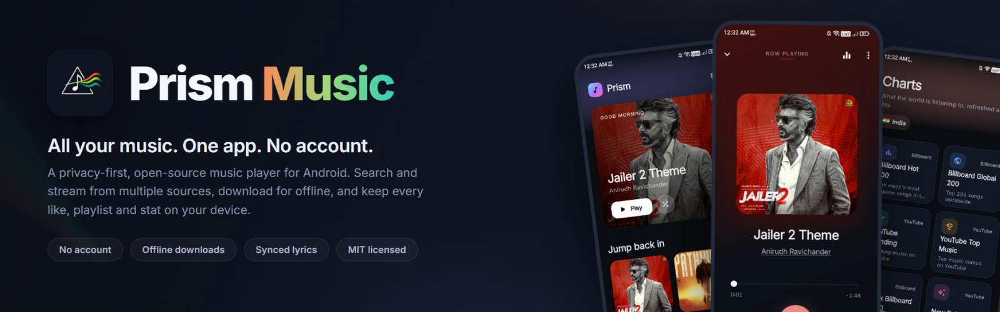
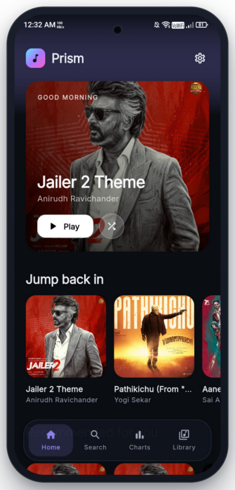
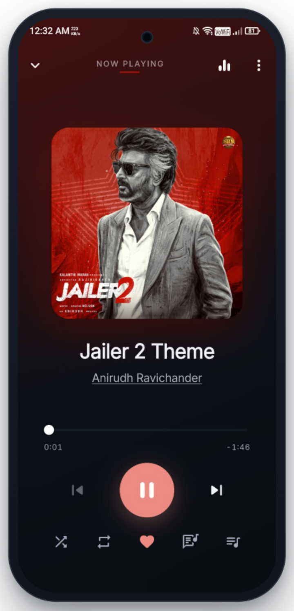
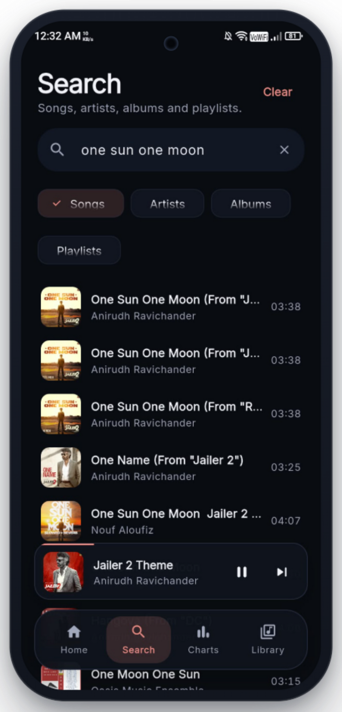
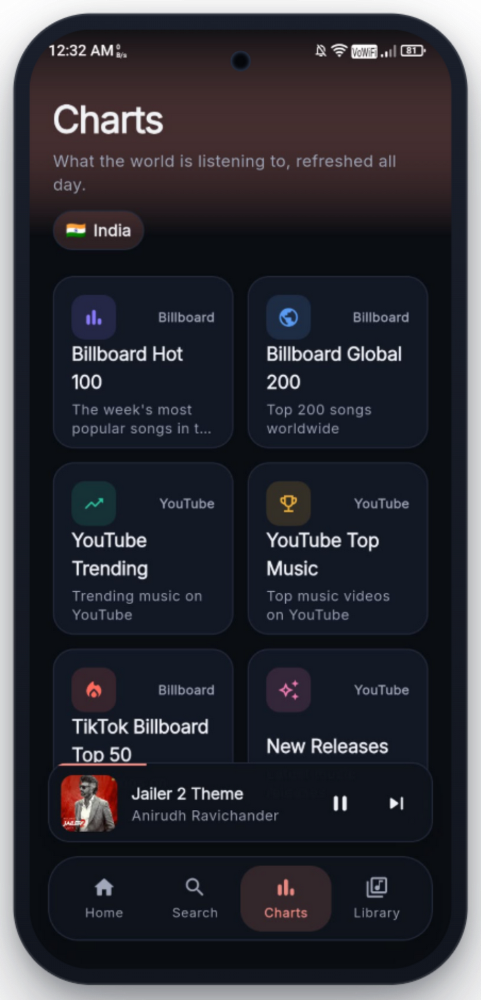
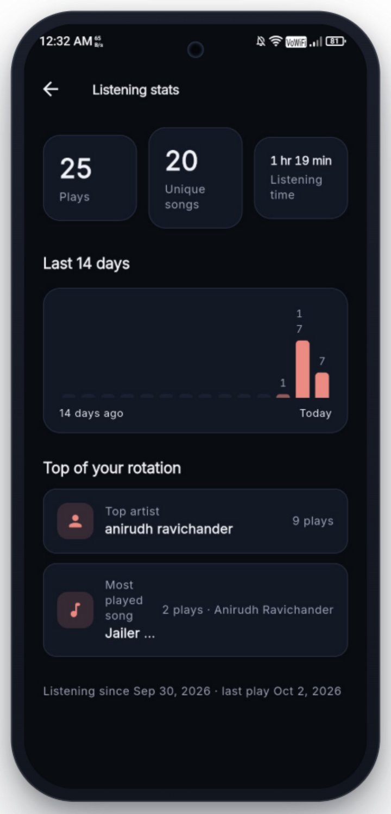
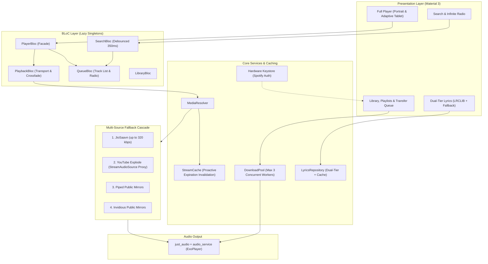

<div align="center">



# Prism Music

**A privacy-first, open-source music streaming and offline player for Android, built with Flutter.**

Search and stream millions of songs from YouTube Music and JioSaavn with line-synced lyrics, lossless audio, smart radio recommendations, adaptive tablet layouts, and native equalizer — completely free, open-source, and on-device. No accounts. No subscriptions. No ads. No telemetry.

[](https://github.com/Jeswanth-009/Prism-Music/actions/workflows/ci.yml)
[](https://github.com/Jeswanth-009/Prism-Music/actions/workflows/pages.yml)
[](https://github.com/Jeswanth-009/Prism-Music/releases)
[](https://github.com/Jeswanth-009/Prism-Music/releases)
[](https://flutter.dev)
[](LICENSE)
[](CONTRIBUTING.md)
[](https://github.com/Jeswanth-009/Prism-Music/releases/latest)

[⬇️ Download](#download--install) · [✨ Features](#features) · [📸 Screenshots](#screenshots) · [⚡ Architecture & How It Works](#architecture--how-it-works) · [🔒 Privacy](PRIVACY.md) · [🌐 Website](https://jeswanth-009.github.io/Prism-Music/) · [🛠️ Local Development](#local-development) · [🤝 Contributing](#contributing)

</div>

---

## 📸 Screenshots

<div align="center">

| Home | Now Playing | Search & Radio |
| :---: | :---: | :---: |
|  |  |  |

| Charts Hub | Listening Stats | Tablet & Landscape |
| :---: | :---: | :---: |
|  |  |  |

</div>

---

## 💡 Why Prism Music?

- 🚫 **Zero accounts or logins**: Search, stream, like, and download directly without ever signing up or handing over an email address.
- 🔒 **100% Local-first data & hardware security**: Likes, playlists, history, and listening metrics live strictly in an encrypted on-device Hive database with zero cloud telemetry. Spotify credentials are encrypted with Android hardware KeyStore / Keymaster.
- ⚡ **Direct HTTPS streaming & proxy resolution**: Audio streams, catalog metadata, and lyrics are fetched directly from external services over HTTPS without intermediary proxy servers or logging middleboxes. ExoPlayer stream proxy prevents media skips.
- 🛡️ **Four-tier fallback resilience**: Automated stream failover (JioSaavn up to 320 kbps → YouTube Explode → Piped → Invidious) backed by an active circuit breaker ensures playback never freezes when a provider experiences downtime.
- 📻 **Infinite Radio recommendations**: Tap any searched track to immediately seed playback and trigger continuous algorithmic recommendations that learn from your listening habits.
- 📥 **Queued download concurrency pool**: Managed background downloads limited to max 3 concurrent active streams with retry logic, network saturation prevention, and audio container integrity checks.
- 📖 **Dual-tier line-synced lyrics**: Line-synced karaoke lyrics powered by LRCLIB with an automated secondary fallback provider and persistent offline caching.
- 📐 **Adaptive tablet & landscape player**: Responsive split dual-pane player for tablets, foldables, and landscape mode.
- 🚀 **Automated CI/CD pipeline**: Every commit to `main` passes full static analysis (`flutter analyze`), automated tests (`517+` tests), and publishes signed Android APKs and AABs with SHA-256 checksums and provenance attestations.

---

## ✨ Features

### 🎧 Streaming Engine & Audio Architecture
- **Multi-Source Fallback Chain**: Resolves tracks with high availability: JioSaavn (up to 320 kbps) → YouTube Explode (`StreamAudioSource` proxy) → Piped (4 public mirrors) → Invidious (6 public mirrors) with a 15-second total resolution budget.
- **Audio Quality Tiers & Format Badging**: Low (64 kbps), Medium (128 kbps), High (256 kbps), and Ultra (320 kbps Opus/AAC). The full player prominently displays live stream format badges (e.g. `160 kbps · OPUS` or `OFFLINE`).
- **Proactive Stream Cache Invalidation**: Tracks stream URL expiration times and proactively invalidates stale CDN links before playback resume, eliminating stalled resume attempts.
- **Native Equalizer & Audio Effects**: Dynamically bound to the active audio session ID with ±6 dB treble shelf, bass boost, and presets (Flat, Bass+, Rock, Vocal, Electronic).
- **Seamless Crossfade & Audio Focus**: 0–10 second configurable crossfade with authoritative audio focus orchestration that respects system interruptions and never auto-resumes after an explicit user pause.

### 📱 Full Player, Dual-Tier Lyrics & UI Polish
- **Dual-Tier Lyrics Engine**: Real-time line-synced karaoke lyrics powered by LRCLIB, backed by an automated secondary fallback lyrics provider with persistent offline caching and manual sync offset adjustment.
- **Adaptive Tablet & Landscape Mode**: Fluid two-column player layout on wide screens and foldables: album art, format badges, and transport controls on the left; lyrics, queue, and recommendations on the right.
- **Staggered Animations & Reduced-Motion Accessibility**: Smooth list animations and page transitions with graceful degradation to reduced-motion skeleton shimmers when accessibility options are set.
- **100% Offline Typography**: Complete Inter font family weights bundled on-device in `ThemeBloc`, guaranteeing fast, identical typography without runtime Google Fonts network requests.
- **Persistent Transport Controls**: Lyrics mode preserves prominent Play/Pause, Skip, and seek controls without obscuring lyrics.
- **Dynamic Artwork Accent**: Palette extracted in real time from album art, dynamically tinting the player and background ambient glow.
- **Contextual Error Recovery**: User-friendly error message mapper paired with one-tap retry snackbars for instantaneous recovery.

### 📥 Offline Downloads & Concurrency Pool
- **3-Worker Concurrency Pool**: Queue management pool with max 3 active concurrent downloads, queuing extra items safely to prevent bandwidth starvation or socket exhaustion.
- **Atomic Download Pipeline**: Temporary `.tmp` file downloads with atomic renaming, 60-second timeouts, and audio container integrity validation.
- **Rich Transfer Queue**: View active downloads with real-time percentage progress, cancel actions, song titles, artist names, and album art thumbnails.
- **Offline Library Search**: Metadata and artwork cached locally for fully functional offline playback.

### 📚 Library, Persistence & Smart Discovery
- **Infinite Radio from Search**: Tapping any song from search seeds the playback queue and automatically populates continuous recommended tracks.
- **Universal Playlist Import**: Import public Spotify and YouTube playlists via URL with token-based fuzzy matching, exponential backoff, and 429 rate-limit retry handling.
- **Hardware-Secure Keystore**: Client credentials and tokens stored in Android hardware KeyStore / Keymaster.
- **14-Day Listening Analytics**: Visual play history chart with screen reader semantics, top artists, top songs, and lifetime statistics.
- **Privacy Disclosures**: Clear on-device storage notices explaining that play counts and history remain strictly on your phone.
- **Last.fm Scrobbling**: Optional integration to scrobble plays directly to your Last.fm profile.

---

## 📊 Feature Comparison

| Feature | Prism Music | Spotify Free | YouTube Music Free | Generic Players |
|---|:---:|:---:|:---:|:---:|
| **Account Required** | ❌ **No** | ✅ Yes | ✅ Yes | ❌ No |
| **Advertisements** | ❌ **None** | ⚠️ Audio & Video Ads | ⚠️ Video Ads | ⚠️ Banner Ads |
| **Offline Downloads** | ✅ **Free & Local** | ❌ Paywalled | ❌ Paywalled | ⚠️ Local files only |
| **Download Concurrency** | ✅ **Max 3 Queued Pool** | ❌ Paywalled | ❌ Paywalled | ❌ Single thread / Unmanaged |
| **Line-Synced Lyrics** | ✅ **Dual-Tier (LRCLIB + Fallback)** | ⚠️ Restricted | ⚠️ Basic | ❌ Missing |
| **Multi-Source Failover** | ✅ **4 Independent Sources** | ❌ Single CDN | ❌ Single CDN | ❌ N/A |
| **Adaptive Tablet Layout** | ✅ **Split Dual-Pane** | ⚠️ Basic | ⚠️ Basic | ⚠️ Varies |
| **Native Equalizer** | ✅ **Built-in** | ⚠️ Basic | ⚠️ Basic | ⚠️ Varies |
| **First-Party Tracking** | ❌ **Zero Telemetry** | ⚠️ Extensive | ⚠️ Extensive | ⚠️ Ad trackers |
| **Hardware Keystore** | ✅ **Keymaster Encrypted** | ❌ Proprietary | ❌ Proprietary | ❌ Plaintext / SharedPreferences |
| **Open Source** | ✅ **MIT License** | ❌ Proprietary | ❌ Proprietary | ⚠️ Varies |

---

## ⚡ Architecture & How It Works

Prism Music is built on a clean, layered architectural model powered by lazy singleton BLoCs, decoupled mixins, and an active fallback cascade:

- **Presentation Layer**: Material 3 pages and widgets, adaptive tablet split view, vinyl layout, and docked navigation.
- **BLoC State Management**:
  - `PlayerBloc`: Central facade coordinating audio playback, queue management, and service coordination.
  - `PlaybackBloc`: Dedicated playback lifecycle, stream setup, and crossfade orchestration.
  - `QueueBloc`: Queue mutation, shuffle, loop, and algorithmic infinite radio seeding.
  - Feature Mixins: `ScrobbleMixin`, `SleepTimerMixin`, `DynamicPaletteMixin`.
  - `SearchBloc`: 350ms debounced queries with throttled pagination.
  - `LibraryBloc`: Local playlists, likes, and import state.
  - `ThemeBloc`: Complete offline Inter typography and theme switching.
- **Core Engine & Data Layer**:
  - `MediaResolver`: Resolves streaming URLs with proactive cache expiration checks.
  - `DownloadService`: Concurrency pool managing up to 3 simultaneous downloads with queued transfers.
  - `LyricsRepository`: Dual-tier resolution via LRCLIB and secondary fallback with local cache.
  - `SecureStorageService`: Keystore-backed credential security.



---

## ⬇️ Download & Install

### Installation Steps
1. Download the latest release APK from the [GitHub Releases](https://github.com/Jeswanth-009/Prism-Music/releases) page.
2. Open the downloaded `.apk` file on your Android device.
3. If prompted, enable **"Install from unknown sources"** for your browser or file manager.
4. Tap **Install** and launch Prism Music.

> [!NOTE]
> **System Requirements**: Android 7.0 (Nougat, API level 24) or higher.
> Architectures supported: `arm64-v8a` (recommended), `armeabi-v7a` (32-bit legacy), `x86_64` (emulator / PC).

---

## 🛠️ Local Development

### Prerequisites
- **Flutter SDK**: `3.38.4` (stable channel)
- **Dart SDK**: `3.8+`
- **Java Development Kit**: JDK 17
- **Android SDK**: Platform API 34+
- Physical Android device or emulator

### Getting Started

```bash
# Clone the repository
git clone https://github.com/Jeswanth-009/Prism-Music.git
cd Prism-Music

# Install dependencies
flutter pub get

# Run static analysis (0 warnings, 0 infos)
flutter analyze --no-fatal-infos --no-fatal-warnings

# Run full automated test suite (517+ tests)
flutter test

# Launch on connected device
flutter run
```

### Build Release Artifacts

```bash
# Release APK (Optimized ARM64)
flutter build apk --release

# Universal Android App Bundle (AAB)
flutter build appbundle --release
```

---

## 📚 Documentation Index

| Guide | Description |
|---|---|
| [ARCHITECTURE.md](ARCHITECTURE.md) | Architectural layers, dependency injection, and BLoC contracts |
| [STREAM_ARCHITECTURE.md](STREAM_ARCHITECTURE.md) | Multi-source resolution, stream caching, prefetching, and fallback rules |
| [PRIVACY.md](PRIVACY.md) | Transparent privacy disclosures, permission usage, and local data storage |
| [BACKEND_INTEGRATION.md](BACKEND_INTEGRATION.md) | Direct API mappings for catalog search, metadata, and lyrics |
| [docs/TESTING.md](docs/TESTING.md) | Testing strategy across unit, widget, golden, and integration tests |
| [docs/RELEASE_CHECKLIST.md](docs/RELEASE_CHECKLIST.md) | Automated CI/CD release pipeline and verification steps |
| [LASTFM_SETUP.md](LASTFM_SETUP.md) | Guide to configuring your Last.fm API credentials for scrobbling |
| [CHANGELOG.md](CHANGELOG.md) | Complete release notes and monotonic version history |
| [SECURITY.md](SECURITY.md) | Security policy and vulnerability disclosure guidelines |

---

## 🤝 Contributing

Contributions are warmly welcome! Whether fixing bugs, submitting feature suggestions, or polishing translations:
- Please check existing [Issues](https://github.com/Jeswanth-009/Prism-Music/issues) before opening a new one.
- Follow the conventional commit style (e.g. `feat(player): ...`, `fix(search): ...`, `docs(readme): ...`).
- Ensure all tests pass (`flutter analyze && flutter test`) before submitting pull requests.
- Read [CONTRIBUTING.md](CONTRIBUTING.md) for full contribution guidelines.

---

## 📄 License & Acknowledgments

Prism Music is open-source software licensed under the [MIT License](LICENSE).

Special thanks to the open-source projects and communities that make Prism Music possible:
- [Flutter](https://flutter.dev) & [Dart](https://dart.dev)
- [`just_audio`](https://pub.dev/packages/just_audio) & [`audio_service`](https://pub.dev/packages/audio_service) by Ryan Heise
- [`flutter_bloc`](https://pub.dev/packages/flutter_bloc) by Felix Angelov
- [`hive`](https://pub.dev/packages/hive) by Simon Leier
- [`youtube_explode_dart`](https://pub.dev/packages/youtube_explode_dart)
- [LRCLIB](https://lrclib.net) for synced lyrics
- [Piped](https://github.com/TeamPiped/Piped) & [Invidious](https://github.com/iv-org/invidious) communities
