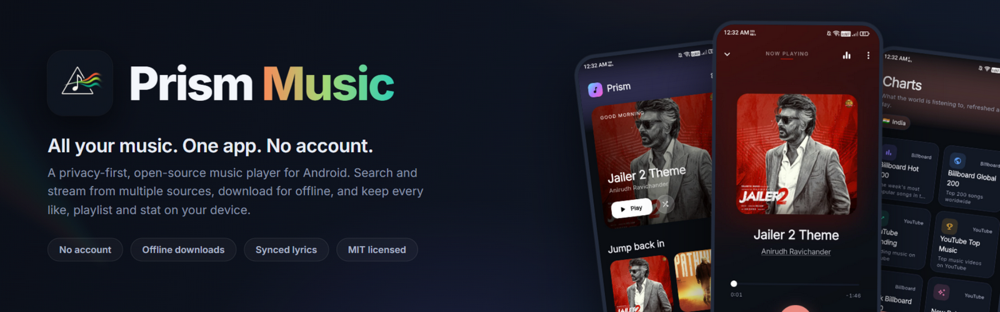
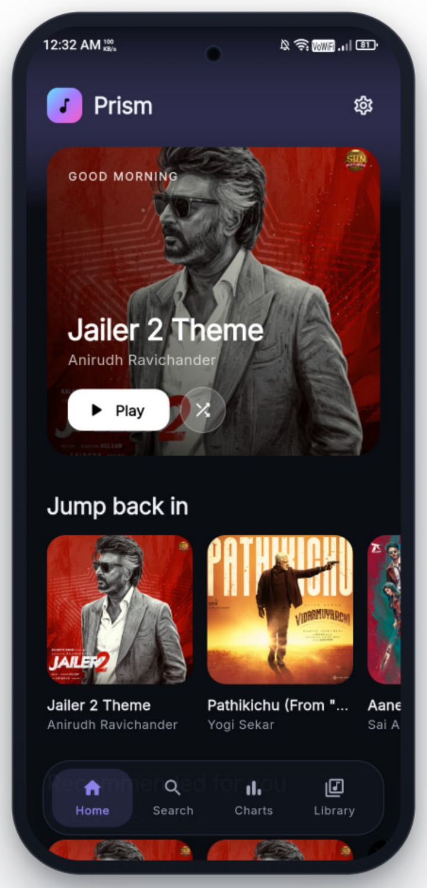
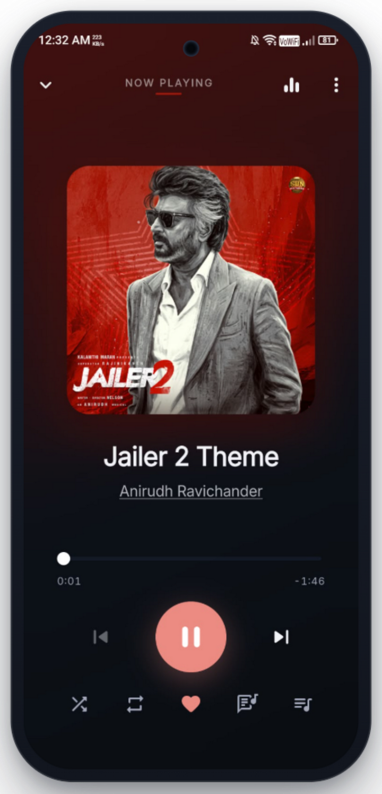
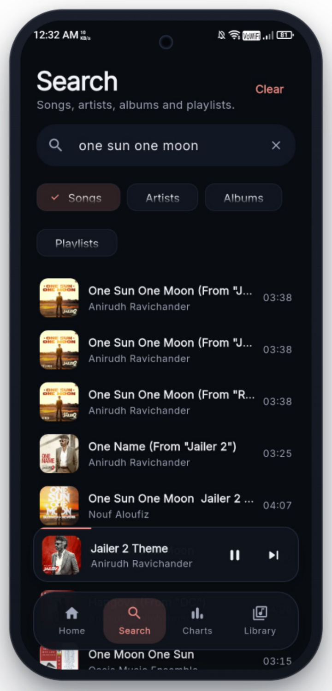
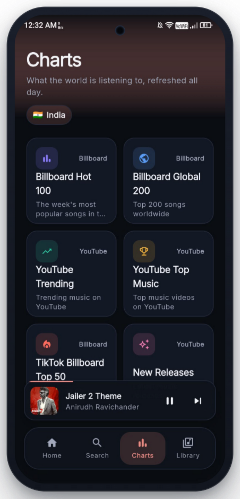
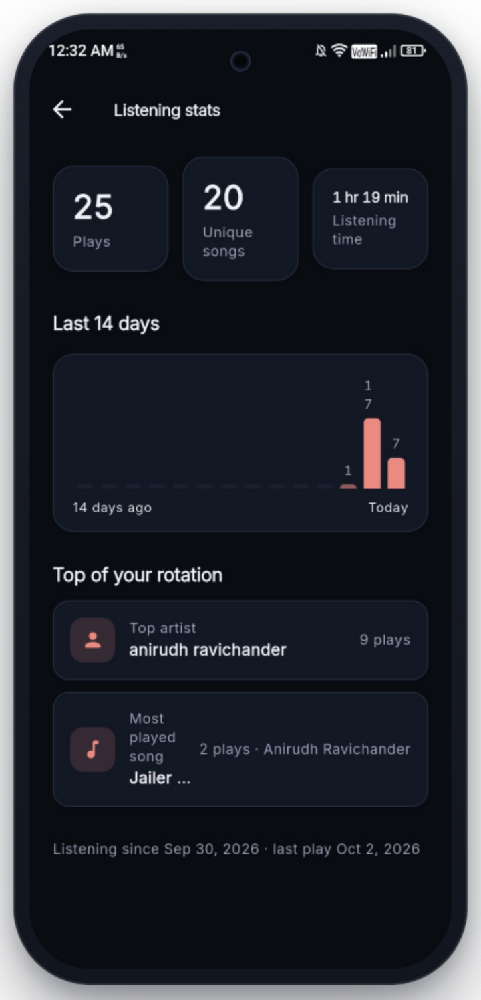
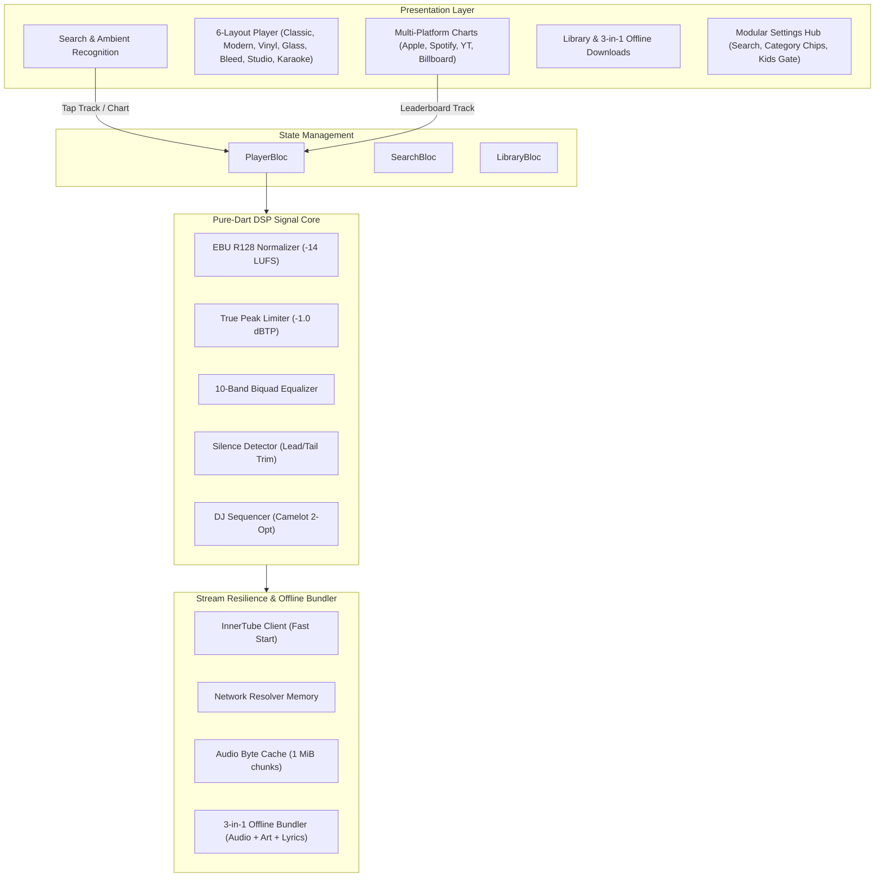

<div align="center">



# Prism Music

**A privacy-first, open-source music streaming and offline player for Android, Windows, and Linux, built with Flutter.**

Search and stream millions of songs from YouTube Music, JioSaavn, Apple Music & Spotify charts with word-by-word synchronized lyrics, honest Ultra (320 kbps) audio, 6 dedicated player layouts, pure-Dart DSP signal core, and on-device intelligent radio — completely free, open-source, and on-device. No accounts. No subscriptions. No ads. No telemetry.

[](https://github.com/Jeswanth-009/Prism-Music/actions/workflows/ci.yml)
[](https://github.com/Jeswanth-009/Prism-Music/releases/latest)
[](https://github.com/Jeswanth-009/Prism-Music/releases/latest)
[](https://apps.obtainium.imranr.dev/redirect?r=obtainium://add/https://github.com/Jeswanth-009/Prism-Music)
[](https://flutter.dev)
[](LICENSE)
[](CONTRIBUTING.md)
[](https://github.com/Jeswanth-009/Prism-Music/releases/latest)

[⬇️ Download](#download--install) · [✨ Features](#features) · [🎨 Player Layouts](#6-dedicated-player-layouts) · [⚡ DSP & Audio Core](#pure-dart-dsp-signal-core) · [📊 Charts](#multi-platform-streaming-charts) · [🔒 Privacy](PRIVACY.md) · [🌐 Website](https://jeswanth-009.github.io/Prism-Music/) · [📚 Documentation](#documentation) · [🤝 Contributing](#contributing)

</div>

---

## 📸 Screenshots

<div align="center">

| Home | Now Playing | Search & Radio |
| :---: | :---: | :---: |
|  |  |  |

| Multi-Platform Charts | Listening Stats | Equalizer & DSP |
| :---: | :---: | :---: |
|  |  |  |

</div>

---

## ⬇️ Download & Install

| Method | Description | Link |
|---|---|---|
| **Direct APK** | Recommended universal ARM APK for Android 7.0+ | [Download Latest APK](https://github.com/Jeswanth-009/Prism-Music/releases/latest) |
| **Obtainium** | One-click install & automatic background updates *(Android only — requires [Obtainium](https://github.com/ImranR98/Obtainium))* | [](https://apps.obtainium.imranr.dev/redirect?r=obtainium://add/https://github.com/Jeswanth-009/Prism-Music) |
| **Desktop** | Windows x64 zip & Linux x64 tarball binaries | [GitHub Releases](https://github.com/Jeswanth-009/Prism-Music/releases/latest) |

> 💡 **Obtainium Tip:** Obtainium is an Android app manager. If clicking the badge on a PC/Mac, it will show a redirect page because desktop browsers do not have the `obtainium://` protocol handler. Open the badge on your **Android device** or manually paste `https://github.com/Jeswanth-009/Prism-Music` into the Obtainium app's **Add App** tab.

---

## 💡 Why Prism Music?

- 🚫 **Zero accounts or logins**: Search, stream, like, and download directly without ever signing up or handing over personal credentials.
- 🔒 **100% Local-first data**: Likes, playlists, history, and listening metrics live strictly in sandbox-isolated on-device storage. Hardware-backed secure storage (Android Keystore / iOS Keychain) protects sensitive tokens.
- 🎚️ **6 Dedicated Player Layouts**: Switch on the fly between Modern, Classic, Vinyl, Glassmorphism, Full Bleed Canvas, Studio Reference, and Karaoke Sing mode.
- 🎛️ **Pure-Dart DSP Signal Core**: Studio-grade audio processing without platform latency — EBU R128 loudness normalization (-14 LUFS), true-peak limiting (-1.0 dBTP), 10-band biquad graphic equalizer, silence trimming, and Camelot harmonic key detection.
- 🎧 **Honest Audio Quality**: Transparent bitrate labeling ("Ultra 320 kbps Opus/AAC") with live stream format badging (`320 kbps · AAC`, `160 kbps · OPUS`, `OFFLINE`). No deceptive lossless marketing claims.
- 📦 **3-in-1 Atomic Offline Bundler**: Download songs with high-resolution artwork and word-by-word synced LRC lyrics packaged together with atomic integrity checks and a real-time storage breakdown meter.
- 📈 **Multi-Platform Streaming Charts**: Real-time aggregated leaderboards across Apple Music Top 50, Spotify Top 50, YouTube Music Trending, and Billboard Hot 100 with Gold, Silver, Bronze badges and movement indicators.
- 🎛️ **Smart DJ Sequencer**: Algorithmic set ordering using Camelot wheel harmonic distance, octave-free tempo matching, and 2-opt trajectory optimization.
- 🔍 **Zero-Key Audio Recognition**: On-device SongRec-style Hann FFT spectral peak fingerprinting that matches songs without requiring private or paid API keys.
- 🛡️ **Kids Mode & Content Safety**: 4-digit salted SHA-256 parent PIN gate with automatic explicit content filtering and lyric profanity masking.

---

## ✨ Flagship Systems

### 🎨 6 Dedicated Player Layouts
Prism Music lets you tailor the playback experience to your taste with 6 purpose-built UI layouts:
1. **Modern**: Dynamic album palette blur, prominent artwork canvas, and floating transport pills.
2. **Classic**: Compact, intuitive 5-button transport bar with persistent timeline scrubber and quick controls.
3. **Vinyl**: Audiophile turntable aesthetic with rotating 33 RPM vinyl record art and an animated tonearm.
4. **Glass**: Frosted glassmorphism with dynamic translucency, glowing neon aura, and floating deck controls.
5. **Full Bleed**: Edge-to-edge full artwork immersion with adaptive gradient scrim and minimalist gestures.
6. **Studio**: Audio engineer reference monitor featuring a real-time 32-band spectrum visualizer and acoustic metrics.
7. **Karaoke (Sing)**: Full-bleed lyric scroll featuring word-by-word synchronized syllable sweeping for singing along.

### ⚡ Pure-Dart DSP Signal Core
All audio mathematics are computed on-device in clean, pure Dart:
- **EBU R128 Loudness Normalization**: Measures integrated loudness (LUFS) across K-weighted frequency filters to ensure every track plays at a consistent -14 LUFS broadcast standard without jarring volume jumps.
- **True-Peak Limiter**: Safeguards against inter-sample peaks with a -1.0 dBTP ceiling, eliminating digital clipping distortion.
- **10-Band Biquad Graphic Equalizer**: Standard ISO frequency centers (`31Hz`, `62Hz`, `125Hz`, `250Hz`, `500Hz`, `1kHz`, `2kHz`, `4kHz`, `8kHz`, `16kHz`) with ±12 dB gain adjustment across presets (Rock, Pop, Jazz, Electronic, Bass Boost, Vocal) and custom user curves.
- **Silence Detector**: Automatic lead and tail silence trimming with configurable RMS thresholds, providing tight, seamless song transitions.
- **Onset & Key Estimator**: Analyzes spectral flux to determine BPM and Camelot musical keys (e.g. `8B / C Major`) for harmonic transitions.

### 📦 3-in-1 Offline Download Bundler
Offline playback is no longer just a raw audio file:
- **Simultaneous Packaging**: Automatically downloads and verifies the audio track, high-resolution album cover, and word-by-word synced LRC lyrics into sandbox-isolated storage.
- **Storage Breakdown Meter**: Visually displays offline storage consumption split across Audio files, Artwork caches, and Lyrics data.
- **Verification Badging**: Verified tags (`[Ultra 320 kbps]`, `[ART OK]`, `[LYRICS OK]`) guarantee full offline completeness.

### 📈 Multi-Platform Streaming Charts
Browse what the world is listening to without leaving the app:
- **Apple Music Top 50**: Official real-time RSS chart feed.
- **Spotify Top 50**: Global and regional hit rankings.
- **YouTube Music Trending**: Live viral music video and audio stream leaderboards.
- **Billboard Hot 100**: Definitive industry singles chart with mirror fallback.
- **Honest Discovery Mixes**: Clear transparency disclosures distinguishing verified official rankings from curated algorithmic discovery mixes.

### 🎛️ DJ Sequencer & Harmonic Mixing
- Orders playlist tracks to minimize key clashes along the Camelot wheel.
- Penalizes artist repetition and harmonic dissonance using 2-opt trajectory optimization.
- Generates bar-aligned crossfade cue points based on tempo and energy curves.

### 🔍 Zero-Key Audio Recognition
- Generates 16 kHz mono Hann FFT spectrograms directly from microphone PCM buffers.
- Extracts spectral landmark peak constellations into binary `.sig` signatures.
- Queries Shazam's public discovery gateway with zero proprietary API credentials required, backed by acoustic query search.

### 🛡️ Kids Mode & Parental Gate
- Protected by a 4-digit parent PIN hashed with salted SHA-256.
- Prevents unauthorized exit or access to explicit tracks.
- Automatically masks explicit words in titles and lyrics with asterisks.

---

## 📊 Feature Comparison

| Feature | Prism Music | Spotify Free | YouTube Music Free | Generic Players |
|---|:---:|:---:|:---:|:---:|
| **Account Required** | ❌ **No** | ✅ Yes | ✅ Yes | ❌ No |
| **Advertisements** | ❌ **None** | ⚠️ Audio & Video Ads | ⚠️ Video Ads | ⚠️ Banner Ads |
| **Player Layouts** | ✅ **6 Dedicated Layouts** | ❌ 1 Fixed | ❌ 1 Fixed | ⚠️ 1–2 Basic |
| **Word-by-Word Lyrics** | ✅ **Included (LRCLIB & Syllable)** | ⚠️ Line only | ⚠️ Basic | ❌ Missing |
| **Multi-Platform Charts** | ✅ **Apple + Spotify + YT + Billboard** | ❌ Spotify only | ❌ YouTube only | ❌ None |
| **3-in-1 Offline Bundler** | ✅ **Audio + Art + Lyrics** | ❌ Paywalled | ❌ Paywalled | ⚠️ Audio only |
| **DSP Normalization & 10-Band EQ** | ✅ **EBU R128 + 10-Band Biquad** | ⚠️ Basic volume | ⚠️ None | ⚠️ Varies |
| **DJ Harmonic Sequencer** | ✅ **Camelot + 2-Opt Optimizer** | ❌ None | ❌ None | ❌ None |
| **Zero-Key Audio Recognition** | ✅ **Built-in On-Device** | ❌ Third-party app | ❌ None | ❌ None |
| **Kids Mode with PIN Gate** | ✅ **Salted SHA-256 PIN** | ⚠️ Kids App required | ❌ None | ❌ None |
| **First-Party Tracking** | ❌ **Zero Telemetry** | ⚠️ Extensive | ⚠️ Extensive | ⚠️ Ad trackers |
| **License** | ✅ **MIT License** | ❌ Proprietary | ❌ Proprietary | ⚠️ Varies |

---

## ⚡ How It Works

Prism Music is built on a clean, layered architectural model:
- **Presentation**: Pages, widgets, and BLoC state managers (`PlayerBloc`, `SearchBloc`, `LibraryBloc`, `ThemeBloc`).
- **Domain**: Pure entities (`Song`, `Album`, `Artist`, `Playlist`, `Lyrics`, `SongScanData`) and repository contracts.
- **Data**: Implementations of repositories, local Hive data sources, and secure streaming clients.
- **Core / DSP**: Pure-Dart DSP audio math (`EbuR128`, `BiquadEqualizer`, `OnsetDetector`, `KeyEstimator`, `SilenceDetector`), stream resilience with network memory, and atomic download bundler.



---

## 🛠️ Local Development

### Prerequisites
- **Flutter SDK**: 3.38.4+ (stable channel)
- **Dart SDK**: 3.8+
- **Android Studio / Android SDK**: Platform API 34+
- Physical Android device or emulator

### Getting Started

```bash
# Clone the repository
git clone https://github.com/Jeswanth-009/Prism-Music.git
cd Prism-Music

# Install dependencies
flutter pub get

# Run static analysis (0 warnings enforced)
flutter analyze

# Run full automated test suite
flutter test

# Launch on connected device
flutter run
```

---

## 📚 Documentation Index

| Guide | Description |
|---|---|
| [ARCHITECTURE.md](docs/ARCHITECTURE.md) | Architectural layers, dependency injection, and BLoC contracts |
| [STREAM_ARCHITECTURE.md](docs/STREAM_ARCHITECTURE.md) | Multi-source resolution, stream caching, prefetching, and fallback rules |
| [PRIVACY.md](PRIVACY.md) | Transparent privacy disclosures, permission usage, and local data storage |
| [BACKEND_INTEGRATION.md](docs/BACKEND_INTEGRATION.md) | Direct API mappings for catalog search, metadata, and lyrics |
| [docs/TESTING.md](docs/TESTING.md) | Testing strategy across unit, widget, golden, and integration tests |
| [docs/RELEASE_CHECKLIST.md](docs/RELEASE_CHECKLIST.md) | Automated CI/CD release pipeline and verification steps |
| [CHANGELOG.md](CHANGELOG.md) | Complete release notes and monotonic version history |
| [SECURITY.md](SECURITY.md) | Security policy and vulnerability disclosure guidelines |

---

## 🤝 Contributing

Contributions are warmly welcome! Whether fixing bugs, submitting feature suggestions, or polishing translations:
- Please check existing [Issues](https://github.com/Jeswanth-009/Prism-Music/issues) before opening a new one.
- Follow conventional commit style (e.g. `feat(dsp): ...`, `fix(security): ...`).
- Ensure all tests pass (`flutter analyze && flutter test`) before submitting pull requests.
- Read [CONTRIBUTING.md](CONTRIBUTING.md) for full contribution guidelines.

---

## 📄 License & Acknowledgments

Prism Music is open-source software licensed under the [MIT License](LICENSE).

Special thanks to the open-source projects and communities that make Prism Music possible:
- [Flutter](https://flutter.dev) & [Dart](https://dart.dev)
- [`just_audio`](https://pub.dev/packages/just_audio) & [`audio_service`](https://pub.dev/packages/audio_service) by Ryan Heise
- [`flutter_bloc`](https://pub.dev/packages/flutter_bloc) by Felix Angelov
- [`hive`](https://pub.dev/packages/hive) by Simon Leier
- [LRCLIB](https://lrclib.net) for synced lyrics
