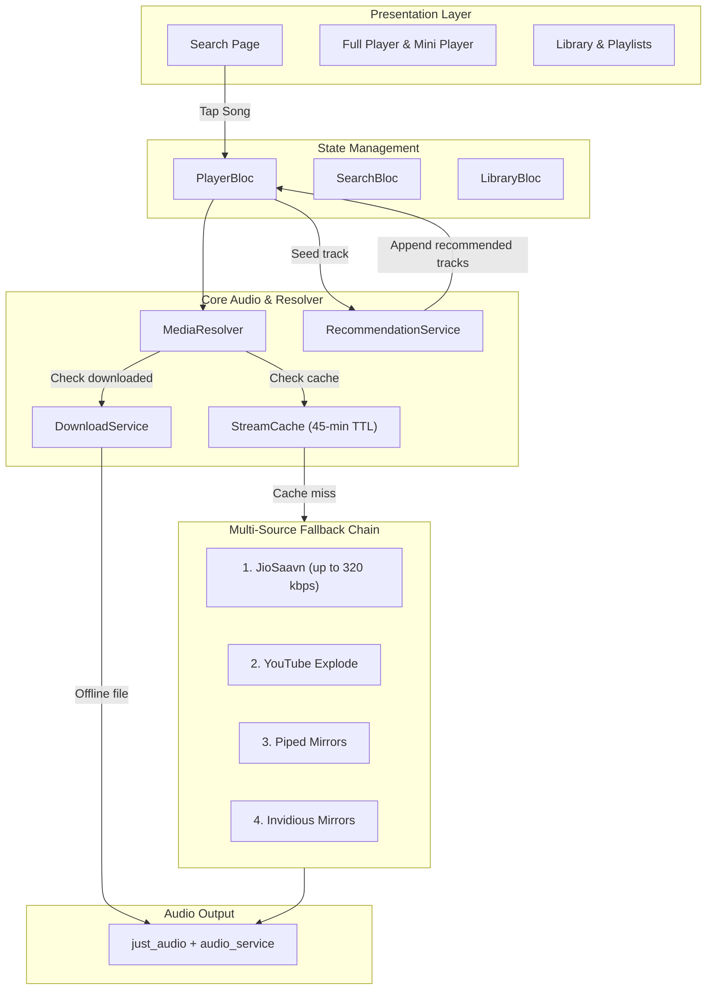

<div align="center">


# Prism Music

**A privacy-first, open-source music streaming and offline player for Android, built with Flutter.**

Search and stream millions of songs from YouTube Music and JioSaavn with line-synced lyrics, lossless audio, smart radio recommendations, and native equalizer — completely free, open-source, and on-device. No accounts. No subscriptions. No ads. No telemetry.

[](https://github.com/Jeswanth-009/Prism-Music/actions/workflows/ci.yml)
[](https://github.com/Jeswanth-009/Prism-Music/releases)
[](https://github.com/Jeswanth-009/Prism-Music/releases)
[](https://flutter.dev)
[](LICENSE)
[](CONTRIBUTING.md)
[](https://github.com/Jeswanth-009/Prism-Music/releases/latest)

[⬇️ Download](#download--install) · [✨ Features](#features) · [📸 Screenshots](#screenshots) · [⚡ How It Works](#how-it-works) · [🔒 Privacy](PRIVACY.md) · [🌐 Website](https://jeswanth-009.github.io/Prism-Music/) · [📚 Documentation](#documentation) · [🤝 Contributing](#contributing)

</div>

---

## 📸 Screenshots

<div align="center">

| Home | Now Playing | Search & Radio |
| :---: | :---: | :---: |
|  |  |  |

| Charts Hub | Listening Stats | |
| :---: | :---: | :---: |
|  |  | |

</div>

---

## 💡 Why Prism Music?

- 🚫 **Zero accounts or logins**: Search, stream, like, and download directly without ever signing up or handing over an email address.
- 🔒 **100% Local-first data**: Likes, playlists, history, and listening metrics live strictly in an encrypted on-device database with zero cloud telemetry. Backups live in app-private storage with optional manual JSON export.
- ⚡ **Direct HTTPS streaming**: Audio streams, catalog metadata, and lyrics are fetched directly from external services over HTTPS without intermediary proxy servers or logging middleboxes.
- 🛡️ **Four-tier fallback resilience**: Automated stream failover (JioSaavn up to 320 kbps → YouTube Explode → Piped → Invidious) backed by a circuit breaker ensures playback never freezes when a provider experiences downtime.
- 📻 **Infinite Radio recommendations**: Tap any searched track to immediately seed playback and trigger continuous algorithmic recommendations that learn from your listening habits.
- 🚀 **Automated CI/CD pipeline**: Every commit to `main` passes full static analysis (`flutter analyze`), automated tests, and publishes signed Android APKs and AABs with SHA-256 checksums.

---

## ✨ Features

### 🎧 Streaming Engine & Audio Architecture
- **Multi-Source Fallback Chain**: Resolves tracks with high availability: JioSaavn (up to 320 kbps) → YouTube Explode → Piped (4 public mirrors) → Invidious (6 public mirrors) with a 15-second total resolution budget.
- **Audio Quality Tiers & Format Badging**: Low (64 kbps), Medium (128 kbps), High (256 kbps), and Ultra (320 kbps Opus/AAC). The full player prominently displays live stream format badges (e.g. `160 kbps · OPUS` or `OFFLINE`).
- **Composite Stream Caching**: Keyed by `videoId` and quality tier with expiration parsing, enabling instantaneous repeat playback and reduced bandwidth usage.
- **Native Equalizer & Audio Effects**: Dynamically bound to the active audio session ID with ±6 dB treble shelf, bass boost, and presets.
- **Seamless Crossfade & Audio Focus**: 0–10 second configurable crossfade with authoritative audio focus orchestration that respects system interruptions and never auto-resumes after an explicit user pause.

### 📱 Full Player, Lyrics & UI Polish
- **Line-Synced Lyrics (LRCLIB)**: Real-time karaoke-style auto-scroll, manual timing sync offset adjustment, and offline lyrics caching.
- **Persistent Transport Controls**: Lyrics mode preserves prominent Play/Pause, Skip, and seek controls without obscuring lyrics.
- **Playback Error Recovery**: If an audio stream fails mid-session, an inline recovery banner provides instant one-tap retry without disrupting the user.
- **Dynamic Artwork Accent**: Palette extracted in real time from album art, dynamically tinting the player and background glow.
- **Docked Navigation & Unified Spacing**: Docked bottom navigation bar with keyboard focus accessibility and consistent `PrismSpacing` tokens across every collection view.

### 📥 Offline Downloads & Transfer Queue
- **Atomic Download Pipeline**: Temporary `.tmp` file downloads with atomic renaming, 60-second timeouts, and audio container integrity checks.
- **Rich Transfer Queue**: View active downloads with real-time percentage progress, cancel actions, song titles, artist names, and album art thumbnails.
- **Offline Library Search**: Metadata and artwork cached locally for fully functional offline playback.

### 📚 Library, Persistence & Smart Discovery
- **Infinite Radio from Search**: Tapping any song from search seeds the playback queue and automatically populates continuous recommended tracks.
- **Universal Playlist Import**: Import public Spotify and YouTube playlists via URL with token-based fuzzy matching and local storage.
- **14-Day Listening Analytics**: Visual play history chart with screen reader semantics, top artists, top songs, and lifetime statistics.
- **Privacy Disclosures**: Clear on-device storage notices explaining that play counts and history remain strictly on your phone.
- **Last.fm Scrobbling**: Optional integration to scrobble plays directly to your Last.fm profile.

---

## 📊 Feature Comparison

| Feature | Prism Music | Spotify Free | YouTube Music Free | Generic Players |
|---|:---:|:---:|:---:|:---:|
| **Account Required** | ❌ **No** | ✅ Yes | ✅ Yes | ❌ No |
| **Advertisements** | ❌ **None** | ⚠️ Audio & Video Ads | ⚠️ Video Ads | ⚠️ Banner Ads |
| **Offline Downloads** | ✅ **Free & Local** | ❌ Paywalled | ❌ Paywalled | ⚠️ Local files only |
| **Line-Synced Lyrics** | ✅ **Included (LRCLIB)** | ⚠️ Restricted | ⚠️ Basic | ❌ Missing |
| **Multi-Source Failover** | ✅ **4 Independent Sources** | ❌ Single CDN | ❌ Single CDN | ❌ N/A |
| **Native Equalizer** | ✅ **Built-in** | ⚠️ Basic | ⚠️ Basic | ⚠️ Varies |
| **First-Party Tracking** | ❌ **Zero Telemetry** | ⚠️ Extensive | ⚠️ Extensive | ⚠️ Ad trackers |
| **Open Source** | ✅ **MIT License** | ❌ Proprietary | ❌ Proprietary | ⚠️ Varies |

---

## ⚡ How It Works

Prism Music is built on a clean, layered architectural model:
- **Presentation**: Pages, widgets, and BLoC state managers (`PlayerBloc`, `SearchBloc`, `LibraryBloc`, `ThemeCubit`).
- **Domain**: Pure entities (`Song`, `Album`, `Artist`, `Playlist`, `Lyrics`) and repository contracts.
- **Data**: Implementations of repositories, local Hive data sources, and remote clients.
- **Core**: Dependency injection (`get_it`), audio session coordination, stream loading, and download management.



---

## ⬇️ Download & Install

### Installation Steps
1. Download the latest APK from the [Releases](https://github.com/Jeswanth-009/Prism-Music/releases) page.
2. Open the downloaded `.apk` file on your Android device.
3. If prompted, enable **"Install from unknown sources"** for your browser or file manager.
4. Tap **Install** and launch Prism Music.

> [!NOTE]
> **System Requirements**: Android 7.0 (Nougat, API level 24) or higher.
> Architectures supported: `arm64-v8a`, `armeabi-v7a`, `x86_64`.

<details>
<summary>Updating from builds older than <code>alpha-v0.2.21</code>?</summary>

Releases before `alpha-v0.2.21` used temporary debug signatures. If Android shows a "package conflict" error when updating from an older build, uninstall the legacy version once and install the new release. All modern builds share a stable release signature and update seamlessly in place.
</details>

---

## 🛠️ Local Development

### Prerequisites
- **Flutter SDK**: 3.38.4+ (stable channel)
- **Dart SDK**: 3.8+
- **Android Studio / Android SDK**: Platform API 34+
- Physical Android device or emulator

### Getting Started

```bash
# Clone the repository
git clone https://github.com/Jeswanth-009/Prism-Music.git
cd Prism-Music

# Install dependencies
flutter pub get

# Run static analysis
flutter analyze

# Run full automated test suite
flutter test

# Launch on connected device
flutter run
```

### Build Release Artifacts

```bash
# Release APK
flutter build apk --release

# Android App Bundle (AAB)
flutter build appbundle --release
```

---

## 📚 Documentation Index

| Guide | Description |
|---|---|
| [ARCHITECTURE.md](ARCHITECTURE.md) | Architectural layers, dependency injection, and BLoC contracts |
| [STREAM_ARCHITECTURE.md](STREAM_ARCHITECTURE.md) | Multi-source resolution, stream caching, prefetching, and fallback rules |
| [PRIVACY.md](PRIVACY.md) | Transparent privacy disclosures, permission usage, and local data storage |
| [BACKEND_INTEGRATION.md](BACKEND_INTEGRATION.md) | Direct API mappings for catalog search, metadata, and lyrics |
| [docs/TESTING.md](docs/TESTING.md) | Testing strategy across unit, widget, golden, and integration tests |
| [docs/RELEASE_CHECKLIST.md](docs/RELEASE_CHECKLIST.md) | Automated CI/CD release pipeline and verification steps |
| [LASTFM_SETUP.md](LASTFM_SETUP.md) | Guide to configuring your Last.fm API credentials for scrobbling |
| [CHANGELOG.md](CHANGELOG.md) | Complete release notes and monotonic version history |
| [SECURITY.md](SECURITY.md) | Security policy and vulnerability disclosure guidelines |

---

## 🤝 Contributing

Contributions are warmly welcome! Whether fixing bugs, submitting feature suggestions, or polishing translations:
- Please check existing [Issues](https://github.com/Jeswanth-009/Prism-Music/issues) before opening a new one.
- Follow the conventional commit style (e.g. `feat(player): ...`, `fix(search): ...`).
- Ensure all tests pass (`flutter analyze && flutter test`) before submitting pull requests.
- Read [CONTRIBUTING.md](CONTRIBUTING.md) for full contribution guidelines.

---

## 📄 License & Acknowledgments

Prism Music is open-source software licensed under the [MIT License](LICENSE).

Special thanks to the open-source projects and communities that make Prism Music possible:
- [Flutter](https://flutter.dev) & [Dart](https://dart.dev)
- [`just_audio`](https://pub.dev/packages/just_audio) & [`audio_service`](https://pub.dev/packages/audio_service) by Ryan Heise
- [`flutter_bloc`](https://pub.dev/packages/flutter_bloc) by Felix Angelov
- [`hive`](https://pub.dev/packages/hive) by Simon Leier
- [`youtube_explode_dart`](https://pub.dev/packages/youtube_explode_dart)
- [LRCLIB](https://lrclib.net) for synced lyrics
- [Piped](https://github.com/TeamPiped/Piped) & [Invidious](https://github.com/iv-org/invidious) communities
